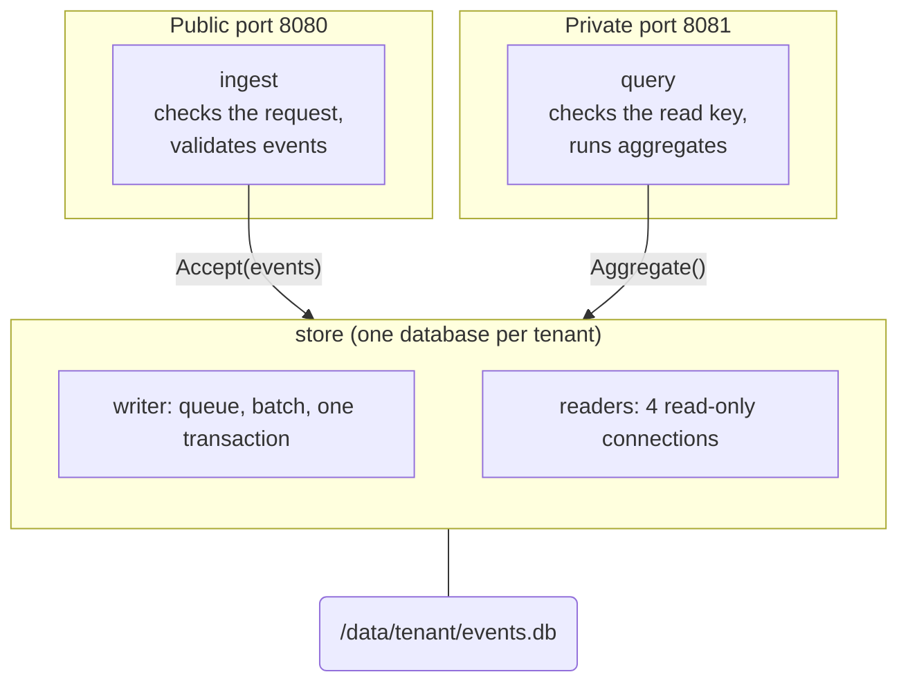
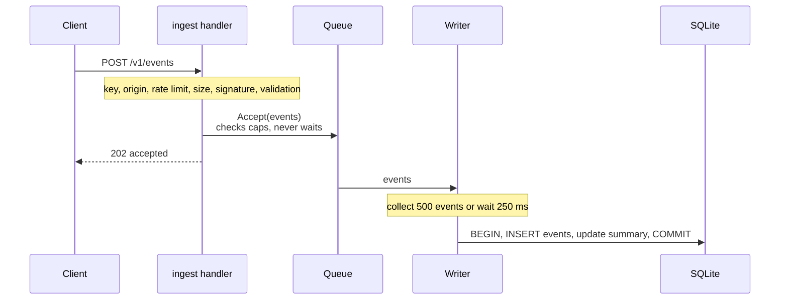
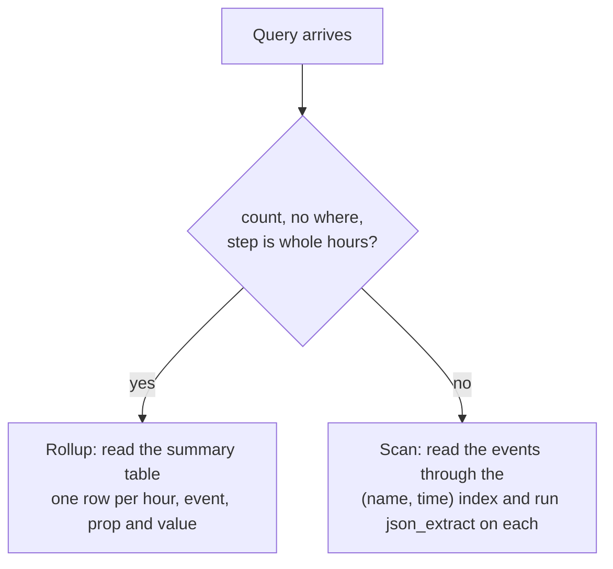
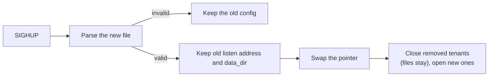

# Architecture

How tallymoth is built. This page is for people changing the code, or running it at large scale. The other pages explain how to use it.

## The big picture

One program with no outside dependencies. It runs two web servers, keeps one SQLite file per tenant, and needs no other service.



## The code

| Folder | What it does |
|---|---|
| `cmd/tallymoth` | The command line. Starts everything, reloads the config, stops cleanly, runs the hourly cleanup. Demo mode is here too. |
| `internal/config` | Reads and checks the YAML. Finds which tenant a key belongs to. |
| `internal/ingest` | The write endpoint: the checks, and the validation of events. |
| `internal/auth` | Signed requests: the message, proof-of-work, signature, replay memory. |
| `internal/limit` | The per-IP rate limit, and finding the client IP behind a proxy. |
| `internal/store` | All the SQLite code: writing, the summary table, queries, retention, upgrades. |
| `internal/query` | The private web API. |
| `tools/bench` | The performance tests. |
| `spec/` | Test data for signing, shared with other languages. |

The folders depend on each other in one direction. `cmd` uses everything. `ingest` and `query` use `config`, `auth`, `limit` and `store`. `store` uses none of our other code.

## Writing an event

When a request arrives, the server does the cheapest checks first, so junk costs little.



Three design choices:

- **One writer per database.** SQLite allows one writer at a time anyway. Saying so in the code avoids lock fights, and lets the writer save hundreds of events in one commit. That is where the speed comes from.
- **Reply before saving.** Waiting for the disk on every request would make writes slow. The price: if the program crashes, up to 250 ms of accepted events are lost. The database stays healthy.
- **Say "slow down" instead of piling up work.** If the queue is full, the server returns `503` with `Retry-After`. It never waits and never grows without limit.

The summary table is updated in the same transaction as the events, so the two can never disagree.

## Reading data

Queries use their own pool of 4 read-only connections. SQLite's WAL mode lets them read while the writer saves, so dashboards do not block writing and writing does not block dashboards.

`store.Aggregate` picks one of two ways to answer:



The summary table (called `rollup` in the code):

```sql
CREATE TABLE rollup (
  h    INTEGER NOT NULL,   -- start of the hour, unix ms
  name TEXT NOT NULL,      -- event name
  k    TEXT NOT NULL,      -- prop name, or '' for the event total
  v    TEXT NOT NULL,      -- prop value as text
  n    INTEGER NOT NULL,   -- how many
  PRIMARY KEY (name, k, h, v)
) WITHOUT ROWID;
```

Values longer than 64 characters are skipped, so free text cannot make the table grow without limit.

User input never becomes SQL text. Event names, prop names and values are bound parameters, and prop names are also checked against a pattern before they are used as JSON paths. The web layer limits queries to 4 at a time, 8 seconds each and 50,000 rows.

## Storage

Each tenant has a folder: `<data_dir>/<tenant>/events.db`. Settings applied when it opens:

| Setting | Value | Why |
|---|---|---|
| `journal_mode` | `WAL` | Readers and the writer do not block each other. |
| `synchronous` | `NORMAL` | No disk sync on every commit. Still safe from corruption in WAL mode. |
| `auto_vacuum` | `INCREMENTAL` | Space freed by retention can be given back gradually. Must be set before the first table exists. |
| `temp_store` | `MEMORY` | The `scratch` image has no `/tmp`, and `GROUP BY` needs temporary space. |
| `busy_timeout` | 5 seconds | Wait a little instead of failing at once. |
| Readers | read-only, 16 MB cache, 256 MB mapping | A bigger cache for queries. |

The SQLite driver is `modernc.org/sqlite`, a Go version of SQLite. It keeps the program a single static file and lets the Docker image be `FROM scratch`.

### Database upgrades

Files like `internal/store/migrations/0002_rollup.sql` are built into the program and only go forward. On open, the store reads `PRAGMA user_version` and runs each missing file in a transaction, together with the version bump. Before changing an existing database it saves `events.db.pre-vN.bak`. A database newer than the program is refused for that tenant only.

To add one, create the next numbered file. `SchemaVersion()` counts the files, so nothing else changes. Remember that on a big database it runs at startup.

### Old events

Every hour, `serve.go` asks each tenant to delete events past `retention_days`. It deletes 5,000 rows at a time with short pauses, so the writer never starves. It also removes the matching summary rows and returns free pages to the disk.

## Config and reload

`config.Load` builds a read-only `*Config`. `serve.go` keeps it in an atomic pointer and each request reads it once, so a reload needs no lock.



Each tenant starts as a copy of `defaults:` and the tenant block is read over it, so a setting the tenant leaves out keeps the default. Unknown keys are errors.

## Memory-only protections

Both stay in memory and are limited in size.

- **Rate limit** (`limit.IP`): a token bucket per tenant and scrambled IP. It holds up to 200,000 entries. When full it drops idle ones first, then an arbitrary tenth.
- **Replay memory** (`auth.Replay`): a queue of signatures, each kept 10 minutes. The time is the same for all, so a plain queue is enough. At 200,000 entries it drops the oldest early, which means a huge flood could let an old signature through again. The code comments say so.

`limit.ClientIP` reads the Nth entry from the **right** of `X-Forwarded-For`, because proxies add to the right and the left side can be faked.

## Stopping

On `SIGTERM` the web servers stop taking requests (10 seconds to finish). Then each database closes its queue, so its writer saves what is left, flushes the WAL and closes the file. The order matters: web servers first, so nothing calls `Accept` on a closed queue. As a second guard, `Accept` checks a `closed` flag under the same lock that protects the queue, so a late call gets an error instead of a crash.

## Keeping things compatible

- **`/v1` only gains optional fields.** Removing or changing one means a new `/v2` next to it.
- **Config `version: 1`.** New settings need defaults that keep old files working.
- **Database changes** are forward-only upgrades, with a backup first.
- **The signing format** is fixed by `spec/vectors.json`. CI rebuilds it with a separate Python script and fails if anything differs.

## Why it is built this way

| Choice | Instead of | Reason |
|---|---|---|
| One SQLite file per tenant | One shared database | Separation, easy retention, deleting a tenant means deleting a folder. |
| Reply before saving | Reply after saving | Speed. Losing 250 ms in a crash is fine for counters. |
| Update the summary on write | Work it out when reading, or in a background job | Fast reads, no extra moving part, and counts cannot drift. |
| Props as JSON text | One column per prop | Each tenant picks its own props, and per-tenant table changes would be a migration headache. |
| Go version of SQLite | The C version | One static file, `scratch` image, easy cross-compiling. |
| Strict schema by default | Accept everything | The server decides what reaches the disk. |
| No request logs | A normal access log | Nothing to leak, nothing to switch off. |
