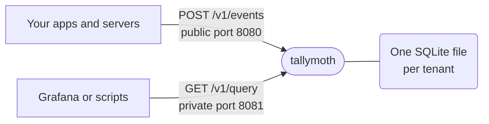

# Concepts

tallymoth does two things. Your apps send it events. Grafana, or anything else that speaks HTTP, asks it for counts.



Port 8080 is the one you put on the internet, behind HTTPS. Port 8081 stays private.

## Tenant

A tenant is one app or one customer. Each tenant has its own database file, keys, limits and retention. A key can only reach its own tenant.

A tenant id is 2 to 32 characters: lowercase letters, digits and `-`. Examples: `shop`, `ops-metrics`.

## Event

An event is a name, a time and some props. "Someone viewed the pricing page" is one event.

```json
{"name": "page_view", "ts": 1794636000000, "props": {"path": "/pricing", "logged_in": false}}
```

| Part | Rules |
|---|---|
| `name` | Lowercase letters, digits, `_` and `.`. Starts with a letter. Up to 48 characters. |
| `ts` | Optional. Unix time in milliseconds. If you leave it out, the server uses the time it received the event. |
| `props` | Optional. A flat object. Values are text (up to 256 bytes), numbers or true/false. No nesting. |

## Context

A batch can have a `context` next to its events. Its props are added to every event in the batch. Use it for values that never change within the batch, like the app version. If an event sets the same prop itself, the event wins.

## Schema: strict or open

The schema decides which props the server keeps.

| | Strict (default) | Open |
|---|---|---|
| Set with | an `events:` list in the config | `schema: open` |
| Event name not in the list | rejected | accepted |
| Prop not in the list | removed, and counted in the reply | accepted |
| Use it for | apps you give to users | servers you control |

A strict tenant lists every event and its props:

```yaml
events:
  page_view: [path, referrer]
  purchase:  [plan, amount]
```

Anything not on the list never reaches the disk. This matters most for apps that ship a key, because anyone can extract that key and send junk. The list limits what the junk can be. Open schemas work only with bearer keys.

## Keys

There are three kinds. Each does one job.

| Key | For | How it is sent |
|---|---|---|
| **Bearer** | Servers you control, sending events | `Authorization: Bearer <secret>` |
| **Signed** | Apps and web pages that carry the key inside them | Signature headers. See [Signing requests](/signing). |
| **Read** | Reading data | `Authorization: Bearer <secret>` on port 8081 |

A write key cannot read, and a read key cannot write. [Authentication](/authentication) shows how to make and use each one.
