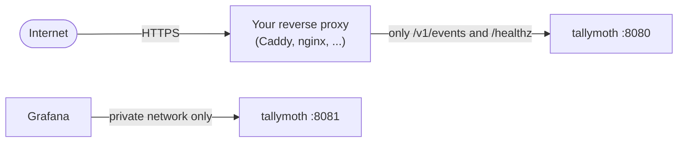

# Docker and reverse proxy

The container speaks plain HTTP. You put your own reverse proxy in front of it to add HTTPS. Any proxy works.



## With Compose

The repository has `deploy/docker-compose.yml`:

```sh
cp deploy/.env.example deploy/.env      # set the secrets your config uses
$EDITOR deploy/config/tallymoth.yaml    # your tenants
docker compose -f deploy/docker-compose.yml up -d
```

It pulls `ghcr.io/javedh-dev/tallymoth` (set `TALLYMOTH_VERSION` to pin a version, otherwise `latest`). Use `docker compose up --build` to build from source instead. It runs the container with the safest settings: read-only filesystem, no extra privileges, a non-root user, and a 128 MB memory limit. The data lives in a volume called `data`, which is the thing to back up. It publishes only the public port, and only on `127.0.0.1`.

Settings for `deploy/.env`:

| Variable | Default | Meaning |
|---|---|---|
| `TALLYMOTH_BIND` | `127.0.0.1` | Which address to publish on. Use `0.0.0.0` if your proxy is on another machine. |
| `TALLYMOTH_PORT` | `8080` | The port on the host. |
| `SCALEBAR_KEY` | empty | The sample config reads this secret. Replace it with the names your own config uses. |

## Without Compose

```sh
docker run -d --name tallymoth --restart unless-stopped \
  --read-only --cap-drop ALL --security-opt no-new-privileges:true \
  -m 128m \
  -p 127.0.0.1:8080:8080 \
  -e TALLYMOTH_TRUST_PROXY=1 -e TALLYMOTH_TRUSTED_HOPS=1 \
  -v tallymoth-data:/data \
  -v $PWD/config:/config:ro \
  ghcr.io/javedh-dev/tallymoth:latest
```

A named volume works right away. For a bind mount, give the folder to user 65532 first: `chown 65532:65532 ./data`.

How much memory it needs is on [Performance](/performance#how-much-memory-does-it-need).

## Reverse proxy

Send only `/v1/events` and `/healthz` to port 8080. Two things matter, whatever proxy you use:

1. **Turn off access logs for these routes.** They would record client IPs, which tallymoth itself never stores.
2. **Tell tallymoth about the proxy.** Set `TALLYMOTH_TRUST_PROXY=1`, and set `TALLYMOTH_TRUSTED_HOPS` to the number of proxies in front: `1` for one proxy, `2` for Cloudflare plus your own.

### Caddy

```text
events.example.com {
    log {
        output discard
    }
    handle /v1/events {
        reverse_proxy 127.0.0.1:8080
    }
    handle /healthz {
        reverse_proxy 127.0.0.1:8080
    }
    handle {
        respond 404
    }
}
```

Caddy gets its own certificate.

### nginx

```nginx
server {
    listen 443 ssl;
    server_name events.example.com;
    # ssl_certificate ... (certbot or similar)

    access_log off;

    location = /v1/events {
        proxy_pass http://127.0.0.1:8080;
        proxy_set_header X-Forwarded-For $remote_addr;
        client_max_body_size 64k;
    }
    location = /healthz {
        proxy_pass http://127.0.0.1:8080;
    }
    location / { return 404; }
}
```

Setting `X-Forwarded-For` to `$remote_addr` throws away anything the client sent, so with `TALLYMOTH_TRUSTED_HOPS=1` the server sees the address nginx saw.

### Check it

```sh
curl https://events.example.com/healthz
```

```text
ok
```

Then send a test event through the proxy ([Send events](/send-events)).

## Letting Grafana reach port 8081

Port 8081 needs a read key, but it should still never be public. In order of safety:

1. **One Docker network.** Put Grafana and tallymoth on the same network, use `http://tallymoth:8081`, and publish nothing.
2. **Localhost only.** Publish `127.0.0.1:8081:8081` and connect through an SSH tunnel or VPN.
3. **Another machine.** Publish on a private address and let only Grafana's address through the firewall.

## Health and logs

The image checks itself: `tallymoth healthcheck` calls `/healthz` on the public port, and `docker ps` shows `healthy`. (The `scratch` image has no `curl`, so the program does it.)

The server logs to stderr: start, config reload and errors. It writes no request logs, and errors never include IPs, headers or request bodies. `docker logs tallymoth` shows them.
