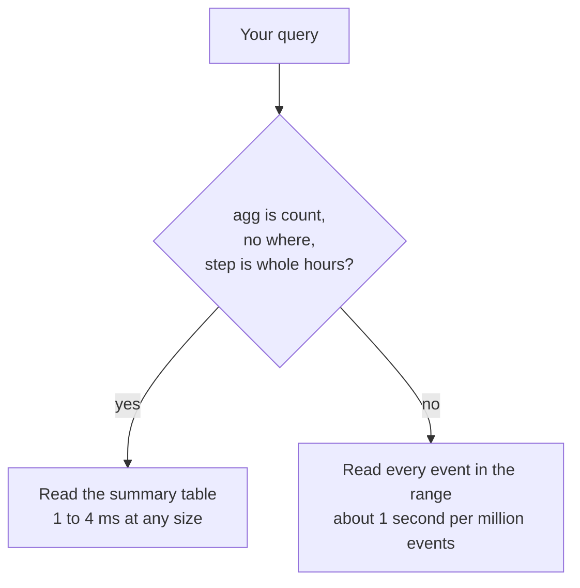

# Query API

The query API returns counts, sums and averages over time, optionally split by a prop. Grafana uses it, and so can any script.

It runs on the **private port**, 8081. Do not put that port on the internet.

## Authentication

Send a [read key](/authentication#read-keys) with every request:

```http
Authorization: Bearer <read secret>
```

The key decides which tenant you read, so you can never see another tenant's data. A write key does not work here.

## `GET /v1/query`

Returns one number per time bucket, or one per bucket and group.

| Parameter | Default | Meaning |
|---|---|---|
| `event` | required | The event name, for example `signup`. |
| `from` | 24 hours ago | Start of the range. Unix milliseconds, or a date like `2026-11-01T00:00:00Z`. |
| `to` | now | End of the range. Same formats. |
| `step` | `1h` | The bucket size: `30s`, `5m`, `1h`, `1d`. At least 1 second. |
| `agg` | `count` | `count`, `sum`, `avg`, `min` or `max`. |
| `field` | none | The prop to add up or average. Needed for everything except `count`. |
| `group_by` | none | A prop. You get one row per bucket and value. |
| `where` | none | `prop:value`. Keep only events where the prop equals the value (compared as text). Repeat it to add more conditions. |

Buckets start at the Unix epoch in UTC. A `1d` bucket starts at 00:00 UTC, whatever your time zone is. A request can cover at most 10,000 buckets.

### The answer

```json
{
  "agg": "count",
  "event": "page_view",
  "rows": [
    {"t": 1794614400000, "group": "search", "value": 12},
    {"t": 1794614400000, "group": "direct", "value": 30}
  ],
  "step_ms": 86400000,
  "tenant": "shop"
}
```

| Field | Meaning |
|---|---|
| `t` | When the bucket starts, in Unix milliseconds. |
| `group` | The prop value. Missing when you did not use `group_by`. Always text, even for numbers (`"15.1"`). |
| `value` | The count, sum or average. |

Empty buckets are left out. When you use `group_by`, events without that prop are left out too.

## Examples

These ran against a live server with a tenant called `ops` (read key `ops-read`) and one called `shop`.

### Events per hour

```sh
curl -G localhost:8081/v1/query \
  -H 'Authorization: Bearer ops-read' \
  -d event=active -d step=1h
```

```json
{"agg":"count","event":"active","rows":[{"t":1794636000000,"value":1}],"step_ms":3600000,"tenant":"ops"}
```

### Split by a prop

Page views per day by referrer, for the last week:

```sh
curl -G localhost:8081/v1/query \
  -H 'Authorization: Bearer shop-read' \
  -d event=page_view -d step=1d -d group_by=referrer \
  -d from=$(( $(date +%s) * 1000 - 7*86400000 ))
```

```json
{"agg":"count","event":"page_view","rows":[{"t":1794614400000,"group":"search","value":1}],"step_ms":86400000,"tenant":"shop"}
```

Only one event had a `referrer`, so there is one row.

### Add up a number

Revenue per day:

```sh
curl -G localhost:8081/v1/query \
  -H 'Authorization: Bearer shop-read' \
  -d event=purchase -d step=1d -d agg=sum -d field=amount
```

```json
{"agg":"sum","event":"purchase","rows":[{"t":1794614400000,"value":49}],"step_ms":86400000,"tenant":"shop"}
```

### Filter

Average cores, only for macOS 15.1:

```sh
curl -G localhost:8081/v1/query \
  -H 'Authorization: Bearer ops-read' \
  -d event=active -d step=1d -d agg=avg -d field=cores -d where=os:15.1
```

```json
{"agg":"avg","event":"active","rows":[{"t":1794614400000,"value":8}],"step_ms":86400000,"tenant":"ops"}
```

Repeat `where` to add conditions: `-d where=os:15.1 -d where=version:1.2.0`.

## `GET /v1/schema`

Lists the events and props a tenant has really stored, so you know what you can ask for.

```sh
curl localhost:8081/v1/schema -H 'Authorization: Bearer ops-read'
```

```json
{
  "events": [
    {"name": "active", "count": 1, "props": ["cores", "os", "version"]},
    {"name": "deploy", "count": 1, "props": ["ok", "os", "secs", "version"]},
    {"name": "signup", "count": 1, "props": ["plan"]}
  ],
  "tenant": "ops"
}
```

`props` is taken from the latest 1,000 events of each name. A prop that has not shown up recently may be missing.

## Speed

Some queries are much faster than others. The server keeps a small summary table with one count per hour, per event and per prop value. It updates the table as events arrive.



| Query | Time |
|---|---|
| `count`, with or without `group_by`, `step` of 1 hour or more | 1 to 4 ms, from 100 thousand to 10 million events |
| `count` with `where`, or `sum`, `avg`, `min`, `max` | about 1 second per million events in the range |

A query that reads every event times out after 8 seconds, which is about 7 million events. Measured numbers are on [Performance](/performance).

Two more details. Summary-table queries start at the beginning of the hour, so only the first and last bucket can differ slightly. And prop values longer than 64 characters are not in the summary table, though `where` still works on them.

So for dashboards, prefer `count` with a step of one hour or more. Keep the other queries to short time ranges.

The server also protects itself: 4 queries at a time (more get `503 busy`), 8 seconds per query, 50,000 rows per answer.

## Errors

Query errors use the same `{"error": "<code>"}` format as the rest. They are in [Error codes](/errors#querying-port-8081).
