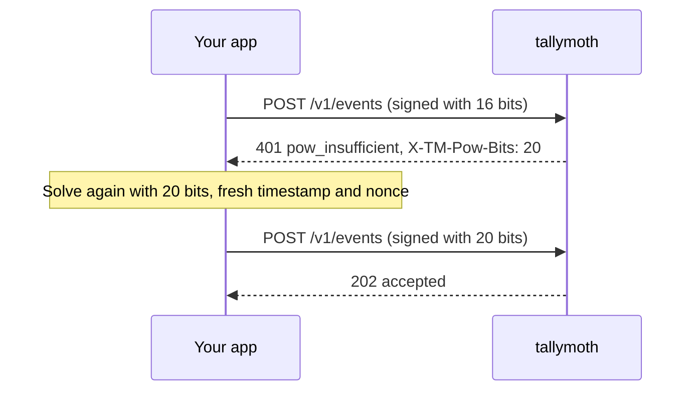

# Signing requests

This page is for people writing the code that sends events from an app or web page that uses a [signed key](/authentication#signed-keys). If you send from your own servers, use a bearer key and skip this page.

## The four steps

For every request:

1. Take the JSON body you will send, as bytes.
2. Join the key id, the current time, a nonce (a number you choose) and the body into one **message**.
3. Change the nonce until the SHA-256 hash of the message starts with enough zero bits. This is the proof-of-work.
4. Sign the message with HMAC-SHA256 and the key's secret. Send the signature in a header.

## The headers

| Header | Value |
|---|---|
| `X-TM-Key` | The key id. |
| `X-TM-Timestamp` | The current time in **seconds** since 1970, as text. It must be within 5 minutes of the server's clock. |
| `X-TM-Nonce` | 1 to 32 characters from `A-Z a-z 0-9 _ -`. The one you found in step 3. |
| `X-TM-Signature` | The HMAC-SHA256 of the message, in lowercase hex. |

## The message

```text
"v1." + keyId + "." + timestamp + "." + nonce + "." + body
```

`body` is the exact bytes you send. Do not sign one copy and send another. There is no JSON re-formatting to worry about.

## The proof-of-work

Count the zero bits at the start of `SHA-256(message)`. It must be at least the tenant's `pow_bits`. Start at a random nonce and add one until it works:

```text
nonce = a random number
while zero_bits(sha256(message with nonce)) < bits:
    nonce = nonce + 1
```

The server tells you the number it wants in the `X-TM-Pow-Bits` header of every response to a signed request. Remember it. If a request fails with `pow_insufficient`, read the header, solve again with that number, and retry once. Do not accept an unreasonably large number: stop at about 22.

Sign after you have found the nonce, because the signature covers the final message.



## A worked example

These numbers come from the shared test vectors, so you can check your code without a server.

| Input | Value |
|---|---|
| key id | `k_test` |
| secret | `tm_sk_test_secret` |
| timestamp | `1763020800` |
| body | `{"events":[{"name":"active"}]}` |
| bits | `8` |

Counting nonces up from `0`, the first one that works is `352`:

```text
message   = v1.k_test.1763020800.352.{"events":[{"name":"active"}]}
sha256    = 00ea267f3c4e3f3c1709bf7132c8f2052f7ea94c20588bba059d2b1d87f5cfc8
signature = 0000ac2a046f0231aabd836642ad818b64f1f9815bb31ae385a96df119407735
```

The hash starts with `00`, which is 8 zero bits. All the vectors are in [`spec/vectors.json`](https://github.com/javedh-dev/tallymoth/blob/main/spec/vectors.json). A Python script that shares no code with the server makes them, and the server's tests check them.

## Code

Both examples were run against a live server and got `202`.

### Python (no extra packages)

```python
import hashlib, hmac, json, secrets, time, urllib.request, urllib.error

def zero_bits(digest: bytes) -> int:
    return len(digest) * 8 - int.from_bytes(digest, "big").bit_length()

def send(url, key_id, secret, payload, bits=16):
    body = json.dumps(payload, separators=(",", ":")).encode()
    ts = str(int(time.time()))
    n = secrets.randbelow(1 << 32)                       # random start
    while True:
        nonce = str(n)
        msg = f"v1.{key_id}.{ts}.{nonce}.".encode() + body
        if zero_bits(hashlib.sha256(msg).digest()) >= bits:
            break
        n += 1
    sig = hmac.new(secret.encode(), msg, hashlib.sha256).hexdigest()
    req = urllib.request.Request(url, body, {
        "Content-Type": "application/json",
        "X-TM-Key": key_id, "X-TM-Timestamp": ts,
        "X-TM-Nonce": nonce, "X-TM-Signature": sig,
    })
    try:
        r = urllib.request.urlopen(req)
        return r.status, r.read().decode(), r.headers.get("X-TM-Pow-Bits")
    except urllib.error.HTTPError as e:
        return e.code, e.read().decode(), e.headers.get("X-TM-Pow-Bits")

print(send("http://localhost:8080/v1/events", "k_shop", "shop-signing-secret",
           {"events": [{"name": "page_view", "props": {"path": "/pricing"}}]}, bits=8))
```

```text
(202, '{"accepted":1,"dropped":{},"rejected":[]}\n', '8')
```

### Node.js (18 or newer)

```js
import { createHash, createHmac, randomInt } from 'node:crypto'

function zeroBits(digest) {
  let n = 0
  for (const b of digest) {
    if (b === 0) { n += 8; continue }
    return n + Math.clz32(b) - 24
  }
  return n
}

export async function send(url, keyId, secret, payload, bits = 16) {
  const body = JSON.stringify(payload)
  const ts = String(Math.floor(Date.now() / 1000))
  let n = randomInt(0, 2 ** 32)
  let nonce, msg
  for (;;) {
    nonce = String(n++)
    msg = Buffer.concat([Buffer.from(`v1.${keyId}.${ts}.${nonce}.`), Buffer.from(body)])
    if (zeroBits(createHash('sha256').update(msg).digest()) >= bits) break
  }
  const signature = createHmac('sha256', secret).update(msg).digest('hex')
  const res = await fetch(url, {
    method: 'POST',
    headers: {
      'Content-Type': 'application/json',
      'X-TM-Key': keyId, 'X-TM-Timestamp': ts,
      'X-TM-Nonce': nonce, 'X-TM-Signature': signature,
    },
    body,
  })
  return { status: res.status, body: await res.json(), powBits: res.headers.get('X-TM-Pow-Bits') }
}
```

In a browser, use `crypto.subtle` instead of `node:crypto`, and search for the nonce in a Web Worker so the page stays responsive.

## Rules to remember

- **Sign again for every retry.** A signature works once. Use a new timestamp and nonce each time, or you get `replay`.
- **Sign the exact bytes you send.**
- **The header timestamp is in seconds.** The `ts` field inside an event is in milliseconds. They are different.
- **Do not log the secret.**

Errors for signed requests (`stale_timestamp`, `pow_insufficient`, `bad_signature`, `replay`) are explained in [Error codes](/errors#sending-events-port-8080).
